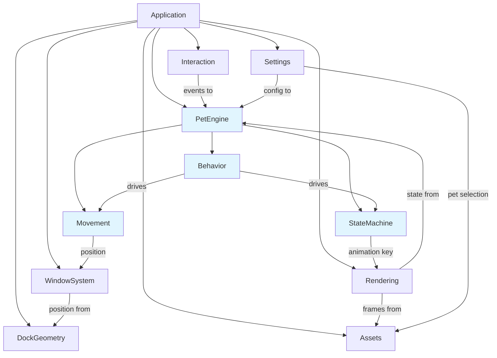

# Architecture

## Overview

DockPet is structured as a set of modular components with strict dependency boundaries. Domain logic (pet behavior, movement, state) is separated from platform code (windows, rendering, Dock detection) to maximize testability.



## Dependency Rules

Arrows indicate allowed dependency direction. Modules MUST NOT depend in the reverse direction.

```
Application → everything (coordinator)
WindowSystem → DockGeometry (for positioning)
Rendering → Assets (for sprite data)
Rendering → PetEngine (for current state/position)
Interaction → PetEngine (delivers events)
PetEngine → nothing platform-specific
Settings → nothing platform-specific
```

**Key constraint:** PetEngine (StateMachine, Movement, Behavior) must have ZERO dependencies on AppKit, NSWindow, rendering, or Dock detection. This enables testing domain logic without a running macOS UI.

---

## Modules

### Application

**Responsibility:** App lifecycle, coordination, menu bar setup.

**Public Interface:**
- App entry point
- Menu bar icon and menu
- Coordination between modules on startup/shutdown

**Dependencies:** All modules (coordinator role).  
**Forbidden Dependencies:** None (it's the root).  
**State Owned:** App lifecycle state.  
**Testability:** Minimal — mostly wiring.

**Notes:**
- Runs as `LSUIElement` (menu bar agent, no Dock icon)
- Manages object lifetimes

---

### WindowSystem

**Responsibility:** Creating and managing the transparent overlay window where the pet is rendered.

**Public Interface:**
- `createPetWindow() → NSWindow`
- `updateWindowPosition(rect: CGRect)`
- `updateWindowSize(size: CGSize)`

**Dependencies:** DockGeometry (for positioning data).  
**Forbidden Dependencies:** PetEngine, Assets, Interaction logic.  
**State Owned:** NSWindow instance, current window frame.  
**Testability:** Integration tests (requires macOS window server).

**Implementation Notes:**
- NSPanel or NSWindow with `styleMask: .borderless`
- `isOpaque = false`
- `backgroundColor = .clear`
- `hasShadow = false`
- `level` set to float above desktop but below system alerts
- `collectionBehavior` configured for Spaces compatibility
- Non-activating (does not steal focus)

---

### DockGeometry

Startup placement uses the current screen's reserved Dock inset, with an injectable `DockPreferences` snapshot for orientation/auto-hide and a provisional custom `tilesize` when the inset is not ready. `PetWindowController` validates geometry twice after showing (0.25s and 1s), then relies on screen-change notifications. No per-frame geometry polling is added. `anchorY × userScale` aligns visible feet on bottom Docks (ADR-020).

**Responsibility:** Detecting Dock position, orientation, and computing pet placement geometry.

**Public Interface:**
- `currentDockOrientation() → DockOrientation` (bottom/left/right)
- `petRegion(for screen: ScreenInfo) → CGRect`
- Notification/callback when geometry changes

**Dependencies:** None (reads NSScreen data, system defaults).  
**Forbidden Dependencies:** PetEngine, Rendering, WindowSystem.  
**State Owned:** Cached Dock orientation and geometry.  
**Testability:** Unit-testable with mock screen geometry.

**Implementation Notes:**
- Infer Dock position by comparing `NSScreen.frame` vs `NSScreen.visibleFrame`
- Optionally read `com.apple.dock` UserDefaults for orientation/autohide (EXPERIMENTALLY_VERIFY)
- Listen for `NSApplication.didChangeScreenParametersNotification`

**Data Types:**
```swift
enum DockOrientation { case bottom, left, right }

struct DockInfo {
    let orientation: DockOrientation
    let screenFrame: CGRect
    let visibleFrame: CGRect
    let dockThickness: CGFloat  // inferred
}
```

---

### PetEngine

The core domain layer. Contains NO platform dependencies.

#### PetEngine / StateMachine

**Responsibility:** Managing pet state and transitions.

**Public Interface:**
- `currentState: PetState`
- `update(deltaTime: TimeInterval)`
- `handleEvent(_ event: PetEvent)`
- `onStateChanged: ((PetState, PetState) -> Void)?`

**Dependencies:** None.  
**Forbidden Dependencies:** AppKit, NSWindow, rendering, assets.  
**State Owned:** Current state, transition timers.  
**Testability:** Fully unit-testable with deterministic time/random inputs.

#### PetEngine / Movement

**Responsibility:** Computing pet position over time within boundaries.

**Public Interface:**
- `currentPosition: CGPoint`
- `currentDirection: Direction`
- `update(deltaTime: TimeInterval, bounds: CGRect)`
- `speed: CGFloat`

**Dependencies:** None.  
**Forbidden Dependencies:** AppKit, NSWindow, rendering.  
**State Owned:** Position, velocity, direction.  
**Testability:** Fully unit-testable.

#### PetEngine / Behavior

**Responsibility:** High-level behavior coordination — decides when to change state, which direction to walk, when to idle.

**Public Interface:**
- `update(deltaTime: TimeInterval)`
- Configuration via `PetPersonality` (future)

**Dependencies:** StateMachine, Movement.  
**Forbidden Dependencies:** AppKit, NSWindow, rendering, assets.  
**State Owned:** Behavior timers, random seed.  
**Testability:** Fully unit-testable with seeded randomness.

---

### Rendering

**Responsibility:** Drawing the current pet sprite to the window.

**Public Interface:**
- `render(sprite: SpriteFrame, at position: CGPoint, in view: NSView)`
- `setAnimationFrames(_ frames: [SpriteFrame], fps: Double)`

**Dependencies:** Assets (sprite data), PetEngine (current state for animation selection).  
**Forbidden Dependencies:** DockGeometry, Interaction, Settings.  
**State Owned:** Current animation frame, frame timer.  
**Testability:** Integration test (needs view), but animation-selection logic can be unit-tested.

**Implementation Notes:**
- `PetCoordinator` owns one CADisplayLink clock for state, movement and `SpriteView.updateAnimation(deltaTime:)`. Rendering has no independent animation timer (ADR-019).
- Each state transition splits elapsed time before advancing the next phase. Walking poses advance only with actual panel travel; special sequences play once over five seconds.
- Small pixel props (cat yarn, footballer sleep marks) are drawn with Core Graphics, preserving source sheets and the active-pet asset cache.
- Nearest-neighbor interpolation: `magnificationFilter = .nearest` (Core Animation) or `filteringMode = .nearest` (SpriteKit)
- Integer scaling only — no fractional sprite sizes
- Retina: work in points, let the system handle backing scale

---

### Assets

**Responsibility:** Loading and managing pet sprite data from the filesystem.

**Public Interface:**
- `loadPet(named: String) → PetAsset`
- `availablePets() → [String]`
- `frames(for state: PetState, pet: String) → [SpriteFrame]`

**Dependencies:** None (filesystem access only).  
**Forbidden Dependencies:** PetEngine, Rendering, WindowSystem.  
**State Owned:** Loaded sprite data, manifest cache.  
**Testability:** Unit-testable with test fixture directories.

**Notes:** See [docs/ASSET_PIPELINE.md](docs/ASSET_PIPELINE.md) for the asset convention.

---

### Interaction

**Responsibility:** Handling mouse events and translating them into pet events.

**Public Interface:**
- `onPetClicked: (() -> Void)?`
- `onMouseNearPet: ((CGPoint) -> Void)?`
- Hit testing for click-through on transparent regions

**Dependencies:** PetEngine (delivers events to state machine).  
**Forbidden Dependencies:** Assets, Settings, DockGeometry.  
**State Owned:** Tracking areas, event monitors.  
**Testability:** Hit-test logic unit-testable; event delivery needs integration test.

---

### Settings

**Responsibility:** User preferences and pet selection.

**Public Interface:**
- `selectedPet: String`
- `setSelectedPet(_ name: String)`

**Dependencies:** None.  
**Forbidden Dependencies:** PetEngine internals, Rendering, WindowSystem.  
**State Owned:** UserDefaults-backed preferences.  
**Testability:** Unit-testable with mock UserDefaults.

---

## File Structure (Planned)

```
DockPet/
├── DockPet.xcodeproj
├── DockPet/
│   ├── Application/
│   │   ├── AppDelegate.swift
│   │   └── MenuBarController.swift
│   ├── WindowSystem/
│   │   └── PetWindowController.swift
│   ├── DockGeometry/
│   │   ├── DockGeometry.swift
│   │   └── DockOrientation.swift
│   ├── PetEngine/
│   │   ├── StateMachine/
│   │   │   ├── PetState.swift
│   │   │   └── PetStateMachine.swift
│   │   ├── Movement/
│   │   │   └── PetMovement.swift
│   │   └── Behavior/
│   │       └── PetBehavior.swift
│   ├── Rendering/
│   │   └── SpriteRenderer.swift
│   ├── Assets/
│   │   ├── AssetLoader.swift
│   │   └── PetManifest.swift
│   ├── Interaction/
│   │   └── PetInteractionHandler.swift
│   ├── Settings/
│   │   └── AppSettings.swift
│   └── Resources/
│       └── Info.plist
├── Assets/
│   └── Pets/
│       ├── Cat/
│       ├── Dog/
│       ├── Parrot/
│       ├── Rabbit/
│       ├── Turtle/
│       ├── Dinosaur/
│       └── Hamster/
└── DockPetTests/
    ├── StateMachineTests.swift
    ├── MovementTests.swift
    ├── DockGeometryTests.swift
    └── AssetLoaderTests.swift
```

## Technology Decisions

See [DECISIONS.md](DECISIONS.md) for the current state of technology choices.

**Settled:**
- Language: Swift
- Platform framework: AppKit (primary)
- App type: Menu bar agent (`LSUIElement`)

**Under Evaluation:**
- Rendering engine: SpriteKit vs Core Animation vs custom NSView drawing
- Animation timing: CADisplayLink vs Timer vs SpriteKit built-in
