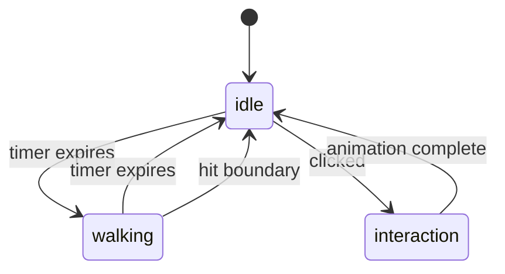
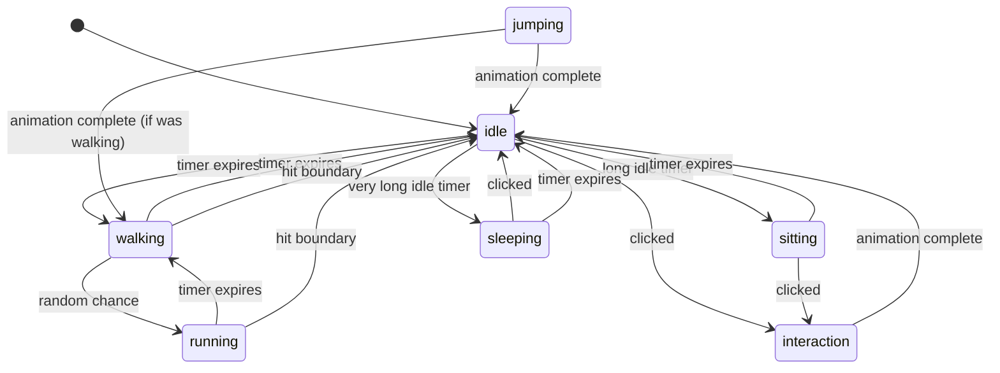

# Pet Behavior System

This document defines the conceptual behavior engine. It separates three concerns:

1. **State** — what the pet is currently doing
2. **Animation** — which sprite frames to display
3. **Movement** — how the pet's position changes

These are related but independent systems. The state machine drives both animation selection and movement behavior, but animation and movement do not depend on each other.

```
State Machine → selects → Animation
State Machine → drives  → Movement
Animation ✗ Movement    (no direct dependency)
```

---

## States

| State | Description | Movement | Animation |
|-------|-------------|----------|-----------|
| `idle` | Pet stands still, minor idle animation | None | Idle loop (breathing, blinking) |
| `walking` | Pet moves horizontally at walk speed | Horizontal, walk speed | Walk cycle |
| `running` | Pet moves horizontally at run speed | Horizontal, run speed | Run cycle |
| `sitting` | Pet sits down, stationary | None | Sit (static or minor loop) |
| `sleeping` | Pet sleeps, stationary | None | Sleep loop (zzz) |
| `jumping` | Pet jumps in place or while moving | Vertical arc (optional horizontal) | Jump (play once) |
| `interaction` | Pet reacts to user click/input | None or minor | Reaction (play once) |

Not all pets need every state. A pet with only `idle` and `walk` sprites is valid. See [Asset Pipeline](ASSET_PIPELINE.md) for fallback rules.

---

## State Transitions

### Core Transition Graph (MVP)



### Extended Transition Graph (Future)



---

## Transition Rules

### Timer-Based Transitions

Most transitions are timer-driven:

1. When entering a state, a **duration** is chosen randomly from a configured range
2. When the duration expires, the state machine transitions to the next state
3. The next state may be chosen randomly with weighted probabilities

Example configuration:

```
idle:
  duration: 2.0 - 6.0 seconds
  transitions:
    walking: 70%
    sitting: 20%
    sleeping: 10%

walking:
  duration: 3.0 - 8.0 seconds
  transitions:
    idle: 80%
    running: 20%
```

### Event-Based Transitions

Some transitions are triggered by external events:

| Event | From States | To State |
|-------|-------------|----------|
| Clicked | idle, walking, sitting, sleeping | interaction |
| Hit boundary | walking, running | idle |
| Animation complete | jumping, interaction | previous state or idle |

### Transition Priority

Events take priority over timers. If the pet is clicked while walking, the click event immediately transitions to `interaction`, canceling the walk timer.

---

## Randomness

### Seeded Randomness

The behavior system should accept an optional random seed for deterministic testing:

```swift
protocol RandomSource {
    func nextDouble() -> Double          // 0.0 ..< 1.0
    func nextDouble(in range: ClosedRange<Double>) -> Double
}
```

In production, use system random. In tests, use a seeded source.

### Random Decisions

| Decision | When | Range |
|----------|------|-------|
| State duration | On state entry | Configured min-max per state |
| Next state | On timer expiry | Weighted probability table |
| Walk direction | On walk entry | 50/50 left/right (or toward center if near edge) |
| Idle variant | On idle entry | If multiple idle animations exist (future) |

---

## Movement

### Horizontal Movement

- Pet moves left or right at a speed defined by the current state and pet type
- Speed is in **points per second**
- Position is updated each tick: `position.x += direction * speed * deltaTime`

### Boundaries

- Pet must stay within the valid movement region (provided by DockGeometry)
- When the pet reaches a boundary:
  - It stops
  - It transitions to `idle`
  - Or it turns around (configurable)

### Direction

- `Direction` is either `.left` or `.right`
- When direction changes, the sprite is flipped horizontally
- The pet does NOT walk through screen edges

### Speed by State

| State | Speed Source |
|-------|-------------|
| `idle` | 0 |
| `walking` | `manifest.movement.walkSpeed` |
| `running` | `manifest.movement.runSpeed` |
| `sitting` | 0 |
| `sleeping` | 0 |
| `jumping` | walkSpeed (horizontal component, if any) |
| `interaction` | 0 |

---

## Animation Selection

The state machine tells the rendering system which animation to play:

```
currentState → animation key → asset lookup → frame sequence
```

Example:
1. State machine enters `walking` state
2. Rendering receives animation key `"walk"`
3. Asset system looks up `walk/` folder for current pet
4. Frames are loaded and cycled at the FPS defined in `manifest.json`

### Animation Playback

- **Looping animations** (`loop: true`): cycle frames continuously (idle, walk, run, sleep)
- **One-shot animations** (`loop: false`): play frames once, then fire a completion event (jump, interaction)
- Frame timing follows the `fps` value in the manifest

### Animation-State Mismatch

If the current state has no corresponding animation folder, the [fallback rules](ASSET_PIPELINE.md) apply.

---

## Personality System (Future)

Eventually, different pet types may have different behavior weights:

```json
{
  "personality": {
    "activityLevel": 0.7,
    "sleepiness": 0.3,
    "curiosity": 0.5
  }
}
```

This would influence:
- How long a pet stays idle vs walking
- How often it sleeps
- How it reacts to mouse proximity

**Not implemented in MVP.** The state machine should be designed so personality weights can be injected later without restructuring.

---

## Testability

The behavior system MUST be testable without:
- NSWindow or any AppKit dependency
- Real pixel art assets
- A running macOS display
- Real-time timers

This is achieved by:
1. Injecting `deltaTime` manually in tests (no real clock dependency)
2. Using a seeded `RandomSource` for deterministic behavior
3. Defining state machine as pure logic with no platform imports
4. Using protocol-based interfaces for animation callbacks
